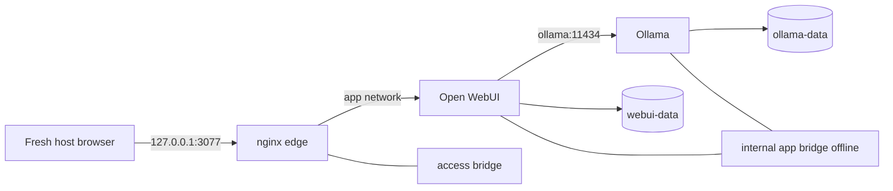

# A document assistant that survives a local internet outage

This lab deploys **Open WebUI + Ollama** on Linux Docker Engine, then rehearses a narrow offline journey: upload a plain-text file, retrieve its supporting passage, and ask a local model for an answer with a cited source. It separates online asset preparation from offline operation. It does **not** claim an airtight air gap, universal plugin isolation, or reliable answers for arbitrary documents.

The recorded results, screenshots, raw log excerpts, and case matrix are in [`evidence/report.md`](evidence/report.md).

## Boundaries



Editable source: [`docs/architecture.mmd`](docs/architecture.mmd). The `webui` and `ollama` containers only join `app`. In offline mode, `app` is a Docker `internal` network. Direct loopback publication from an internal network failed on the test engine, so `edge` joins both `app` and `access` and publishes only to host `127.0.0.1`. **The edge container has an external route** through `access`; its nginx configuration only proxies to `webui:8080`. Inspect your own network and proxy if extending this lab. The host browser is separately denied external access during the rehearsal; Docker networking alone cannot isolate it. The Mac/host management network is never changed.

## Prerequisites and resources

- Linux/ARM64 Docker Engine with the Compose plugin. The recorded run uses the Linux engine inside a disposable Docker Desktop VM on an ARM64 Mac; it is not a bare-metal Linux-host test. On another architecture, resolve and review fresh image digests before use.
- A local browser for the UI rehearsal. Use a fresh profile and a reversible browser-specific external-access block. Keep `localhost` reachable.
- Roughly 5 GB of image/model downloads and several GB of persistent-volume space; 8 GB RAM is a practical minimum for the selected CPU models. The exact observed usage belongs in the run record.
- No hosted model account or paid API. The synthetic fixtures are invented and contain no personal documents.

The images are pinned to **Open WebUI v0.13.4**, **Ollama 0.40.17**, and **nginx 1.31.10-alpine** with resolved digests in [`assets.lock.json`](assets.lock.json). The generator is `qwen2.5:1.5b` (986 MB) and the Ollama embedder is `all-minilm:latest` (45 MB); both pulled manifests are SHA-256 locked. Both model packages report Apache 2.0 licenses (`ollama show MODEL --license`). The `latest` suffix is only a registry locator: `scripts/verify_assets.py` rejects a manifest that has drifted. The lab's fixture text is locally authored.

## Setup and online preparation

From the repository root:

```sh
python3 scripts/init_env.py
python3 - <<'PY'
import json, subprocess
for image in json.load(open('assets.lock.json'))['images'].values():
    subprocess.run(['docker', 'pull', image], check=True)
PY
scripts/lab.sh online
scripts/lab.sh prepare all
python3 scripts/verify_assets.py
python3 scripts/rehearse.py online-warm fixtures/harbor-access.txt \
  'When does the synthetic harbor office open on weekdays?' \
  --expected 09:15 --output .local/online-warm.json
```

`init_env.py` creates a private `.env` with two different random secrets and refuses to overwrite an existing one. The first WebUI start bootstraps a local admin account. Image and model pulls happen **only while connected**. The online rehearsal verifies extraction, embeddings, retrieved source and answer before the outage. Inspect its JSON record; a false `pass` needs investigation.

Persistent volumes: `offline-doc-lab_ollama-data` retains the Ollama model manifests/blobs (generation and embeddings); `offline-doc-lab_webui-data` retains the application database, accounts, uploads, extracted text, and local vector store. The browser profile/cache is outside these volumes. The Open WebUI image contains UI assets and text extraction code. `RAG_EMBEDDING_ENGINE=ollama` avoids a separate Hugging Face embedding cache, and `RAG_TEXT_SPLITTER=character` avoids a first-use tokenizer download. Open WebUI v0.13 defaults to native file tools, which a small model may not use reliably; `DEFAULT_MODEL_METADATA` enables **Preload files** for retrieval injection while retaining native chat mode. The Compose file disables OpenAI API connections, web search, plugins, and version checks; the offline override also sets `OFFLINE_MODE`, Hugging Face offline flags, and Ollama's no-cloud flag. These settings do not block arbitrary configured outbound connections; the network checks matter.

## Offline rehearsal

```sh
scripts/lab.sh offline
docker compose -f compose.yaml -f compose.offline.yaml config --quiet
scripts/lab.sh inspect > .local/offline-inspect.txt
python3 scripts/verify_assets.py
python3 scripts/rehearse.py offline-warm fixtures/harbor-access.txt \
  'When does the synthetic harbor office open on weekdays?' \
  --expected 09:15 --output .local/offline-warm.json
scripts/lab.sh restart
python3 scripts/rehearse.py offline-cold fixtures/harbor-access.txt \
  'When does the synthetic harbor office open on weekdays?' \
  --expected 09:15 --output .local/offline-cold.json
python3 scripts/rehearse.py first-ingestion fixtures/fresh-ingestion.txt \
  'What is the synthetic maintenance switch code? Copy the exact code and cite the file.' \
  --expected marigold-jetty-906 --output .local/first-ingestion.json
```

`offline` removes and recreates **only this project's containers and networks**, retaining named volumes. `restart` creates new application/model/edge containers while retaining volumes. “Cold” means new processes/containers, **not** deleted model assets. The `first-ingestion` file must be new to the volume; use a fresh unique fixture if repeating this run. Compare JSON `sources[].document` and `sources[].metadata` with the fixture and evaluate the answer separately. A correct uncited answer is not a pass.

For the browser check, install Playwright in a disposable local environment and point it at a **preinstalled** Chrome/Chromium binary. This does not download another browser. The script starts a fresh browser context, sends external requests to a dead per-browser proxy, explicitly bypasses that proxy for loopback, uploads the file through the UI, asks the question, captures a source screenshot, and checks that `https://example.com/` fails. It does not change global host networking:

```sh
python3 -m venv .local/browser-venv
.local/browser-venv/bin/pip install 'playwright==1.56.0'
CHROME_BIN=/usr/bin/google-chrome .local/browser-venv/bin/python \
  scripts/browser_rehearse.py fixtures/harbor-access.txt \
  'Read the attached file. Copy its exact weekday opening time and cite the source.' \
  --screenshot .local/ui-citation.png --report .local/browser.json
```

Use your actual Chrome path. The browser-specific proxy failure tests HTTP access; external DNS failure inside the application namespaces is a separate check. On this engine, `nslookup example.com` returned `SERVFAIL` and external `wget` failed, while `ollama:11434` and the host loopback UI succeeded. Check those properties on your own engine, including actual attachments and routes; do not infer them from `internal: true` alone.

For the missing-asset control, use a **separate Compose project and volumes** on port 3078:

```sh
LAB_PROJECT=offline-doc-negative WEBUI_PORT=3078 scripts/lab.sh online
LAB_PROJECT=offline-doc-negative WEBUI_PORT=3078 scripts/lab.sh prepare generator
LAB_PROJECT=offline-doc-negative WEBUI_PORT=3078 scripts/lab.sh offline
WEBUI_PORT=3078 python3 scripts/rehearse.py missing-embedder \
  fixtures/negative-final.txt 'What is the synthetic recovery beacon code?' \
  --expected silver-bay-604 --expect-processing-failure --output .local/missing-embedder.json
LAB_PROJECT=offline-doc-negative WEBUI_PORT=3078 scripts/lab.sh online
LAB_PROJECT=offline-doc-negative WEBUI_PORT=3078 scripts/lab.sh prepare embedder
LAB_PROJECT=offline-doc-negative python3 scripts/verify_assets.py
LAB_PROJECT=offline-doc-negative WEBUI_PORT=3078 scripts/lab.sh offline
WEBUI_PORT=3078 python3 scripts/rehearse.py restored-offline \
  fixtures/negative-final.txt 'What is the synthetic recovery beacon code? Copy the exact code and cite the attached file.' \
  --expected silver-bay-604 --output .local/restored-offline.json
```

The failed upload should have `status=failed`; inspect WebUI logs for the `Ollama embed error (404)` identifying the absent model. A generic connectivity error is not equivalent. The recovery run must show the restored file in retrieved sources and a supported answer. Do not delete a user's existing models or alter the baseline volume.

`scripts/rehearse.py` uses Open WebUI's `POST /api/v1/files/`, processing-status endpoint, and `POST /api/chat/completions` with `files:[{"type":"file","id":"..."}]` to separate processing and retrieved `sources` evidence. The UI journey runs in a real browser as a distinct check. Preserve exact timestamps, commands, exit statuses, logs and screenshots in `evidence/`; a model-generated answer alone is not proof of retrieval.

## Recovery and cleanup

`scripts/lab.sh online` restores the project to its connected preparation network. `scripts/lab.sh down` stops containers but retains both volumes. `scripts/lab.sh destroy` deliberately removes this project's volumes and all contained accounts, uploads, vectors, and model files. For the negative control, prefix each command with `LAB_PROJECT=offline-doc-negative`; destroy that project separately. Restore or close the disposable browser profile after testing. Never run `docker system prune` as part of this lab.

## Limits and sources

The edge proxy remains dual-homed. A Docker internal network may still reach host-gateway services, so it is a practical egress control for this bounded topology rather than a security proof. A browser-specific block tests that browser profile, not every host application. Retrieval and answer quality are checked against the short synthetic passages; no claim extends to arbitrary corpora, web search, plugins, remote auth, or multi-host transfer.

- [Docker Compose networking](https://docs.docker.com/compose/how-tos/networking/) and [internal networks](https://docs.docker.com/reference/cli/docker/network/create)
- [Open WebUI offline guide](https://docs.openwebui.com/tutorials/maintenance/offline-mode/), [configuration](https://docs.openwebui.com/reference/env-configuration/), and [file/chat API](https://docs.openwebui.com/reference/api-endpoints/)
- [Ollama Docker instructions](https://docs.ollama.com/docker)
